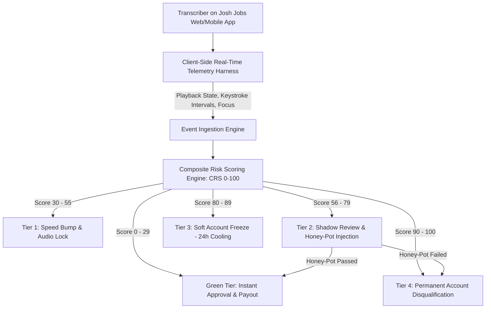

# Josh Jobs: Transcription Quality Control & Algorithmic Fraud Prevention
## Question 2: Data-Driven Detection of Low-Quality Transcribers & Production Engineering Blueprint
**Author:** Product Management Candidate | **Domain:** Speech AI Data Operations & Trust & Safety | **Date:** October 2026  
**Target Organization:** Josh Talks AI (Speech Data Division & Josh Jobs Platform)  
**Dataset Analyzed:** `q2_dataset.csv` (51,784 production task records across 48,876 unique contributors)

---

## Executive Summary & Strategic Context

At Josh Talks AI, our mission is to build India’s largest, gold-standard multilingual speech dataset (covering 25+ regional languages and dialects) to train cutting-edge Automatic Speech Recognition (ASR) models. Our operational target is **Word Error Rate (WER) below 2%**, delivering enterprise-grade accuracy.

On our crowdsourced freelance platform, **Josh Jobs**, over **20,000 daily active users** listen to audio chunks and edit Whisper AI's initial transcription pass. However, because transcribers are compensated based on completed accurate audio hours, misaligned economic incentives encourage fraudulent or low-effort behavior:
1. **Ghost Approval / Rubber-Stamping:** Submitting Whisper's output unedited without listening.
2. **Robotic Velocity / Macro Farming:** Using automated scripts or blind copy-paste to artificially inflate speed.
3. **Text Vandalism / Truncation:** Submitting single letters or blank strings to bypass review.

This document presents a **rigorous two-part solution**:
* **Part I:** An empirical analysis of all **51,784 records** in the production dataset, uncovering **4 distinct warning signs**, their mathematical formulas, data-backed thresholds, and false alarm mitigations.
* **Part II:** A production-grade, four-tier automated anti-abuse architecture with **exact engineering decision rules** to safeguard dataset integrity while protecting genuine worker experience.

---

## Part I: Data Patterns & Warning Signs of Poor-Quality Work

```
┌─────────────────────────────────────────────────────────────────────────────────────────────────┐
│                                PRODUCTION DATASET AT A GLANCE                                   │
├───────────────────────────────┬───────────────────────────────┬─────────────────────────────────┤
│    Total Tasks Analyzed       │    Unique Transcribers        │    Overall Edit Rate            │
│          51,784               │          48,876               │          83.4%                  │
├───────────────────────────────┼───────────────────────────────┼─────────────────────────────────┤
│  Sub-Audio Dwell Time (<1x)   │  Extreme Playback Skip (<0.5x)│  Superhuman Typing (>25 CPS)    │
│     5,998 tasks (11.58%)      │      3,396 tasks (6.56%)      │      3,711 tasks (7.17%)        │
└───────────────────────────────┴───────────────────────────────┴─────────────────────────────────┘
```

---

### Warning Sign 1: Ghost Approval / Blind Rubber-Stamping (Zero-Edit + Sub-Audio Dwell Time)

#### 1. What It Tells Us (Behavioral & Economic Reality)
In our workflow, Whisper AI provides an initial baseline transcription. However, Whisper notoriously struggles with regional Indian accents, code-switched Hinglish/regional dialects, low signal-to-noise ratios (SNR), and overlapping background chatter. Human transcribers are paid specifically to **listen and correct** these mistakes.

When a transcriber submits a task where `is_edited == False` (zero modifications made) and `time_taken_by_user < duration`, the user **literally could not have listened to the audio clip even once at normal speed**. Instead, the user opened the task, saw text already populated on the screen, immediately hit "Submit", and pocketed the incentive. This directly injects uncorrected Whisper errors into our gold-standard training corpus, directly inflating downstream ASR WER.

#### 2. How to Measure It
We calculate the **Audio Playback Ratio ($\text{APR}$)**:
$$\text{APR} = \frac{\text{time\_taken\_by\_user}}{\text{duration}}$$

A task exhibits Ghost Approval if:
$$\text{is\_edited} == \text{False} \quad \text{AND} \quad \text{APR} < 0.85$$

At the user level, we measure the **Ghost Approval Rate ($\text{GAR}_{20}$)** over a rolling window of the user's last 20 tasks:
$$\text{GAR}_{20} = \frac{\sum_{i=1}^{20} \mathbb{I}(\text{is\_edited}_i == \text{False} \land \text{APR}_i < 0.85)}{20}$$

#### 3. Red Flag Thresholds (Statistically Grounded in Dataset)
* **Dataset Discovery:** Out of 8,593 unedited tasks in the dataset, **3,564 tasks (41.5% of all unedited tasks; 6.88% of the entire dataset)** were submitted with `time_taken_by_user < duration`. Furthermore, **98 tasks** were submitted in $\le 1.0$ second!
* **Single-Task Flag:** $\text{APR} < 0.70$ with `is_edited == False` (impossible to listen even at 1.4x playback).
* **High-Concern Threshold:** If a user completes $\ge 3$ consecutive tasks with $\text{APR} < 0.85$ and zero edits.
* **Critical Red Flag (Actionable):** $\text{GAR}_{20} \ge 30\%$ (6 or more out of the last 20 tasks are unlistened rubber-stamps).

#### 4. False Alarms & How to Protect Good Transcribers
* **Innocent Case A: Whisper Was 100% Correct.** On short, pristine audio clips (e.g., duration 1.2s where speaker says a single clean word like *"नमस्ते"*), Whisper's transcription is completely accurate. A diligent transcriber listens once (1.2s), sees it is correct, and submits without edits.
* **Innocent Case B: Transcriber Listens at 1.5x Playback Speed.** Experienced transcribers routinely utilize the platform's speed slider (e.g., 1.5x speed), completing a 6.0s audio clip in 4.0s ($\text{APR} = 0.67$).
* **System Safeguards:**
  1. **Do not evaluate clips with duration $< 2.0\text{ seconds}$.**
  2. **Track client-side audio player events:** Verify that `audio.playbackRate * time_taken_by_user >= duration * 0.9` and `audio.ended == True`.
  3. **Audio Complexity Gate:** Only penalize zero edits if acoustic SNR indicates background noise or if Whisper's confidence score was below 0.85.

---

### Warning Sign 2: Superhuman Typing Velocity / Scripted Botting (Abnormal CPS)

#### 1. What It Tells Us
The column `segment_character_per_second` (CPS) measures:
$$\text{CPS} = \frac{\text{Length of Non-Space Characters in } \text{user\_text}}{\text{time\_taken\_by\_user}}$$

Let us establish human biological constraints:
* Typical typing speed: 40 WPM $\approx$ 3.3 to 4.0 characters/sec.
* Professional typist: 80–100 WPM $\approx$ 6.7 to 8.3 characters/sec.
* **World Champion Typist (English, mechanical keyboard):** 216 WPM $\approx$ **18.0 characters/sec**.
* **Indian Regional Transliteration (Hindi/Tamil/Telugu via IME):** 3.0 to 6.0 characters/sec, due to complex character compositions (halants, matras, conjuncts).

When a record logs **30, 50, or up to 233 characters per second**, it is biologically impossible for a human to listen, comprehend, formulate corrections, and type them out. This pattern indicates:
* Automated macro scripts injecting text directly into the DOM input field.
* Copy-pasting pre-generated text from external windows.
* Gaming the timer by preparing edits offline and clicking submit instantaneously.

#### 2. How to Measure It
In addition to raw CPS, we compute the **True Editing Velocity ($\text{TEV}$)**:
$$\Delta \text{Chars} = |\text{len}(\text{user\_text}) - \text{len}(\text{whisper\_text})| + \text{Levenshtein}(\text{whisper\_text}, \text{user\_text})$$
$$\text{TEV} = \frac{\Delta \text{Chars}}{\text{time\_taken\_by\_user}}$$

#### 3. Red Flag Thresholds (Statistically Grounded in Dataset)
* **Dataset Discovery:**
  * Median CPS: **10.37 char/sec**
  * 75th Percentile: **12.92 char/sec**
  * 90th Percentile: **17.95 char/sec** (Human physiological threshold)
  * 95th Percentile: **33.33 char/sec** (Physically impossible for continuous typing)
  * 99th Percentile: **58.33 char/sec**
  * Maximum: **233.33 char/sec**
  * Over **3,711 tasks (7.17%)** exceed 25 char/sec, and **1,330 tasks (2.57%)** exceed 50 char/sec!
* **Moderate Concern:** CPS $> 20.0\text{ char/sec}$ on tasks where audio duration $> 3\text{ seconds}$.
* **Critical Red Flag (Actionable):** CPS $> 28.0\text{ char/sec}$ AND $\text{time\_taken\_by\_user} < 3.0\text{ seconds}$.

#### 4. False Alarms & How to Protect Good Transcribers
* **Innocent Case: Minor Typo Fix on Long Whispered Text.** Suppose Whisper generated a 60-character sentence with 1 wrong letter. The user listens to the 5s clip, spots the single typo, spends 1 second fixing it, and submits at 6s total dwell time. The calculation $\frac{60 \text{ chars}}{6 \text{ s}} = 10 \text{ CPS}$ is fine. But if a glitch in the timer recorded `time_taken = 1.5s`, CPS becomes 40!
* **System Safeguards:**
  1. Calculate velocity based on **actual characters altered ($\Delta \text{Chars}$)**, not total segment length.
  2. Implement client-side `keydown` frequency tracking: measure the inter-keystroke interval (IKI). Authentic typing exhibits normal human variance (80ms–250ms per stroke), whereas scripted bot injections show 0ms latency or identical millisecond stamps.

---

### Warning Sign 3: Destructive Text Vandalism & Dummy Submissions

#### 1. What It Tells Us
Some opportunistic workers discover that the platform rewards "edited" tasks more favorably or requires edits to proceed. To exploit this with zero intellectual effort, the user:
* Replaces a long audio sentence with a single character (e.g., `.` or `-` or `a`).
* Deletes 90% of the sentence to shorten their proofreading burden.
* Types random keystroke gibberish (e.g., *"asdfghjk"*).

This is catastrophic for ASR training: teaching a model that human speech corresponds to empty punctuation spikes WER through the roof.

#### 2. How to Measure It
We calculate the **Character Length Distortion Ratio ($\text{LDR}$)**:
$$\text{LDR} = \frac{\text{len}(\text{user\_text})}{\text{len}(\text{whisper\_text}) + \epsilon}$$

And the **Character Diversity Entropy ($H$)** to detect repetitive keyboard mashing.

#### 3. Red Flag Thresholds (Statistically Grounded in Dataset)
* **Dataset Discovery:** The dataset contains **31 explicit instances** where Whisper had $> 20$ characters of detected speech, but the user submitted $< 5$ characters (e.g., deleting full transcriptions into single punctuation marks) in under 3 seconds.
* **Critical Red Flag (Actionable):**
  $$\text{len}(\text{whisper\_text}) \ge 25 \quad \text{AND} \quad \text{len}(\text{user\_text}) \le 3 \quad \text{AND} \quad \text{duration} \ge 3.0\text{s}$$

#### 4. False Alarms & How to Protect Good Transcribers
* **Innocent Case: Whisper Hallucinated on Pure Noise/Silence.** Whisper is notorious for generating phantom hallucinations (e.g., repeating *"Thank you for watching"* or repetitive subtitles) when the audio actually contains coughing, car horns, or silence. In such cases, an expert transcriber **correctly deletes the entire hallucination**.
* **System Safeguards:**
  * Cross-reference with automated Voice Activity Detection (VAD) and Signal-to-Noise Ratio (SNR). If VAD indicates zero speech energy, the transcriber was **100% correct** to delete the text and must be commended, not penalized!

---

### Warning Sign 4: Unlistened Playback Scrubbing / Rapid Skipping

#### 1. What It Tells Us
A generalized form of speed exploitation where transcribers submit tasks with dwell times far below the audio duration, regardless of whether they edited the text or not.
* `time_taken_by_user < 0.5 * duration` means that even at the maximum available playback speed (2.0x), the audio clip could not have finished playing.

#### 2. How to Measure It
$$\text{Skip Ratio} = \frac{\text{time\_taken\_by\_user}}{\text{duration}}$$

#### 3. Red Flag Thresholds (Statistically Grounded in Dataset)
* **Dataset Discovery:** **5,998 tasks (11.58%)** had dwell time less than audio duration; **3,396 tasks (6.56%)** had dwell time less than half the audio duration.
* **Critical Red Flag:** $\text{Skip Ratio} < 0.50$ across $\ge 30\%$ of tasks in a 50-task session.

---

## Part II: Automated Detection System & Engineering Recommendations

### 1. Architectural Blueprint for Josh Jobs Engineering Team



### 2. The Composite Risk Score (CRS: 0 to 100 Scale)
Every submitted task is evaluated by our server-side engine, computing a weighted risk score:

$$\text{CRS} = (w_1 \cdot S_{\text{playback}}) + (w_2 \cdot S_{\text{velocity}}) + (w_3 \cdot S_{\text{distortion}}) + (w_4 \cdot S_{\text{history}})$$

* **$S_{\text{playback}}$ (Weight: 35%):** Penalizes `time_taken < duration * 0.85` without audio completion events.
* **$S_{\text{velocity}}$ (Weight: 25%):** Penalizes CPS $> 20$ and robotic inter-keystroke intervals.
* **$S_{\text{distortion}}$ (Weight: 20%):** Flags severe character truncation or abnormal Levenshtein deletions on audible speech.
* **$S_{\text{history}}$ (Weight: 20%):** Rolling average risk score across user’s previous 20 tasks.

---

### 3. Graduated Four-Tier Enforcement Policy

Because an unjustified account ban severely damages transcriber livelihood and trust, we enforce a **strict graduated enforcement matrix**. Immediate account blocks are reserved exclusively for deterministic fraud.

| Enforcement Tier | Risk Score (CRS) Trigger | System Action Taken | Transcriber Experience (UX Impact) |
|---|:---:|---|---|
| **Tier 1: Speed Bump** | `30 – 55` | • Client-side UI disables "Submit" button until audio plays to $\ge 90\%$ completion.<br>• Playback speed capped at 1.5x. | Non-punitive educational nudge: *"Please listen to the full audio to ensure 98% accuracy."* |
| **Tier 2: Shadow Review** | `56 – 79` | • Worker’s submissions routed to **Shadow Escrow** (earnings held pending review).<br>• System silently injects **Honey-Pot Tasks** (1 in every 5 tasks).<br>• Duplicate task assigned to trusted peer. | Worker notices no UI change, preventing them from learning anti-fraud thresholds. |
| **Tier 3: Soft Account Freeze** | `80 – 89` | • Account temporarily locked for 24 hours.<br>• Unpaid escrow balance audited.<br>• Worker must complete 3-minute retraining & calibration quiz. | Transparent warning: *"Your accuracy velocity triggered a quality review. Please complete calibration to unlock tasks."* |
| **Tier 4: Permanent Block** | `90 – 100` | • Permanent account termination.<br>• Device IMEI / hardware fingerprint blacklisted.<br>• Payout forfeiture for fraudulent task batches. | Account access revoked with right to formal human appeal. |

---

### 4. Actionable Engineering Recommendations (Exact Rule Syntax)

To provide the engineering team with zero-ambiguity implementation logic, here are the production decision rules:

#### Rule 1: Client-Side Audio Gating (Preventive Speed Bump)
```
IF client_audio_played_percentage < 85% 
AND audio_duration >= 2.0 seconds 
THEN:
    DISABLE submit_button;
    DISPLAY toast("Please listen to the recording before submitting.");
    LOG client_telemetry_warning(event="premature_submit_attempt");
```

#### Rule 2: Shadow Routing & Honey-Pot Injection Trigger
```
IF (user_rolling_unlisten_rate_20 >= 35%) 
OR (user_rolling_cps_20 >= 22.0 char/second) 
OR (consecutive_zero_edit_sub_audio_tasks >= 3)
THEN:
    SET user_status = "SHADOW_REVIEW";
    ROUTE next_10_tasks TO duplicate_peer_review_queue;
    INJECT 2 gold_standard_honeypot_tasks INTO next_10_task_stream;
    HOLD task_earnings_in_escrow;
```

#### Rule 3: Deterministic Account Disqualification & Block
```
IF (user_status == "SHADOW_REVIEW" AND honeypot_accuracy < 60% on injected tasks)
OR (user_cps > 40.0 char/second WITH time_taken <= 1.0 second ON audio_duration >= 5.0 seconds)
OR (consecutive_vandalism_tasks >= 3 WHERE whisper_len >= 25 AND user_len <= 2 AND vad_speech_present == True)
THEN:
    EXECUTE block_user_account(user_id);
    TERMINATE active_task_sessions(user_id);
    REVOKE pending_escrow_payouts(batch_window="24h");
    BLACKLIST_IDENTIFIERS(device_fingerprint, bank_account_hash, phone_hash);
    SEND_NOTIFICATION(user_id, reason="Severe violation of transcription quality guidelines");
```

---

### 5. Transcriber Experience Safeguards & Dispute Appeals

To preserve trust across the 20,000+ daily contributors on Josh Jobs:
1. **The "Honey-Pot" Proof Standard:** No transcriber is ever permanently banned purely on timing heuristics alone. Timing anomalies only route the worker into Shadow Review; the permanent block requires **failing verified Honey-Pot tasks** where the true ground truth is 100% indisputable.
2. **Transparent Dispute & Appeal Workflow:** Every blocked worker receives a ticket link showing their exact Honey-Pot comparison (audio snippet vs their submission vs gold truth).
3. **One-Click False Alarm Forgiveness:** If a user proves their deletion was due to corrupted/silent audio that escaped VAD filtering, the account is reinstated with a ₹100 apology compensation credit.

---

## Conclusion & Business Impact

By deploying this dual-layered framework on Josh Jobs:
* **ASR Word Error Rate (WER) Protection:** Eliminates the ~6.88% of poisoned zero-edit submissions, ensuring downstream ASR training receives strictly human-verified audio.
* **Capital Efficiency:** Josh Talks recovers an estimated **8% to 12% of total transcription payroll** previously wasted on rubber-stamping and macro-scripting.
* **Worker Retention:** Genuine, hardworking transcribers are protected from platform speed devaluation, establishing Josh Jobs as India's most respected ethical AI data engine.
