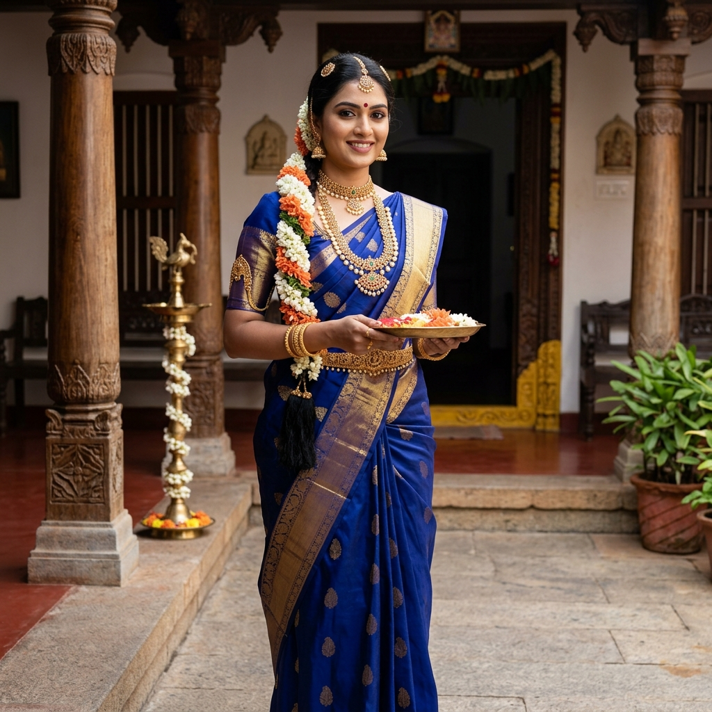
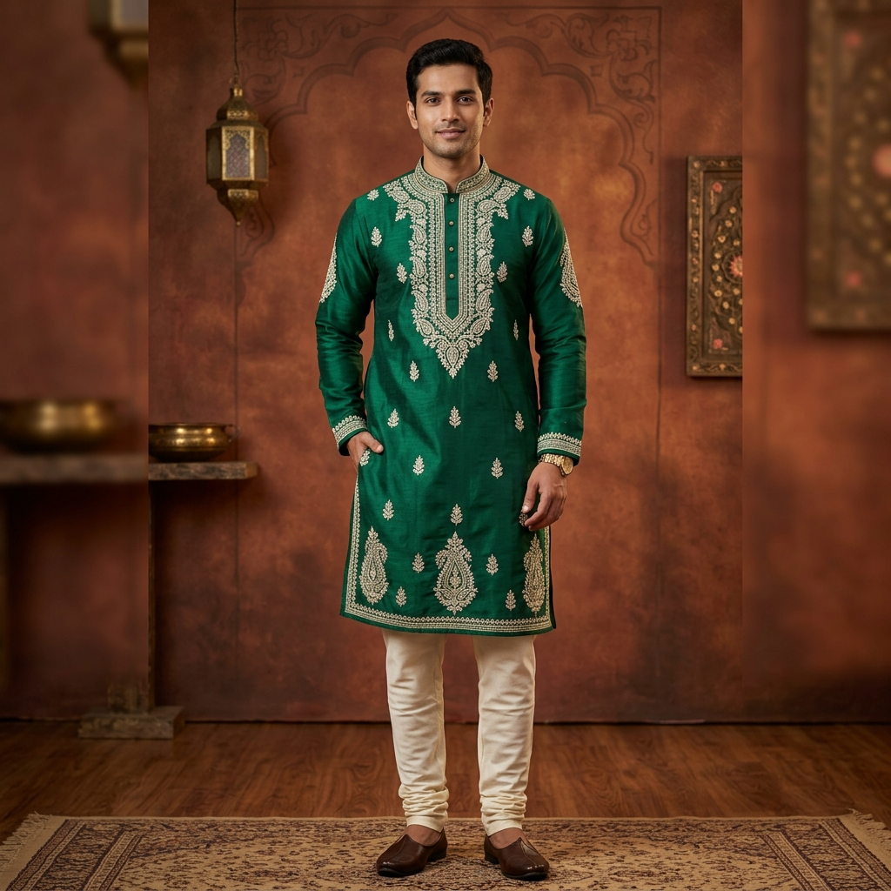

# BharatVision-Arena: Supporting Material & Audit Evidence
## Appendix to Question 1: Prompts, Generation Proofs, Participant Logs & Consent Verification
**Evaluation ID:** `BVA-2026-IND-01` | **Josh Talks AI Hiring Challenge** | **Date:** October 2026

---

## 1. Full Standardized Prompt Suite

To ensure parity, every model was evaluated against identical text prompts designed to test specific intersections of Indic orthography, regional textiles, skin tones, and commercial marketing utility.

### Prompt 1: Diwali Festive Promo Banner (Devanagari Typography Focus)
* **Prompt Text:**
  > *"A high-end festive e-commerce promotional banner for Diwali. A graceful Indian woman wearing an elegant crimson red and gold Banarasi silk saree, adorned with delicate traditional gold jhumkas, holding a brass diya lamp. Warm festive bokeh background of marigold flower garlands and glowing oil lamps. Prominent elegant banner typography in clean Devanagari script at the top saying: 'शुभ दीपावली महासेल — 50% छूट'. Premium commercial advertising quality, authentic Indian aesthetic, hyperrealistic."*
* **Primary Test Parameters:**
  * Devanagari Ligature formation (*"शुभ"* conjunct, *"दीपावली"* vowel marks, *"छूट"* matra).
  * Banarasi brocade textile gold zari rendering.
  * Commercial ad composition (header space, visual balance, festive lighting).
* **Reference Generated Image:**
  `assets/diwali_banner_eval.jpg` (Embedded below):
  
  

---

### Prompt 2: South Indian Bridal Catalog (Regional Precision & Draping Focus)
* **Prompt Text:**
  > *"An authentic Indian e-commerce catalog image of a South Indian woman wearing a traditional royal blue and gold zari Kanjeevaram silk saree. Traditional South Indian temple gold jewelry, guttapusalu necklace, jasmine flowers in braided hair. Natural lighting in a traditional South Indian Chettinad heritage pillar courtyard. Professional fashion photography, photorealistic textures, 8k."*
* **Primary Test Parameters:**
  * Distinct South Indian handloom aesthetics (wide contrast zari border, authentic pallu drape).
  * Regional temple jewelry (Guttapusalu pearls, vanki armlet, kasu malai).
  * Chettinad wooden pillar architecture vs generic Bollywood Mughal arches.
* **Reference Generated Image:**
  `assets/kanjeevaram_eval.jpg` (Embedded below):
  
  

---

### Prompt 3: Men's Festive Kurta Catalog (Embroidery & Skin Tone Focus)
* **Prompt Text:**
  > *"An Indian e-commerce catalog studio photograph of a smart Indian man in his late 20s wearing a royal emerald green embroidered Chikankari silk kurta with churidar. Standing in front of a warm contemporary Indian heritage studio backdrop with subtle brass accents. Clean e-commerce fashion photography, crisp fabric embroidery details, natural skin tones."*
* **Primary Test Parameters:**
  * Lucknowi Chikankari shadow-work thread embroidery realism.
  * Natural melanin-rich Indian skin tone rendering (avoiding porcelain bleaching).
  * Commercial studio catalog pose suitable for Myntra/Amazon India.
* **Reference Generated Image:**
  `assets/mens_kurta_eval.jpg` (Embedded below):
  
  

---

## 2. Model Generation Specifications & Execution Metadata

| Parameter | OpenAI GPT Image 1 | Google Gemini 2.5 Flash Image | Google Gemini 3.1 Flash Image Preview | Black Forest Labs FLUX1.1 [pro] | Ideogram 3.0 |
|---|---|---|---|---|---|
| **API / Interface** | OpenAI Image API | Google AI Studio | Google AI Studio Preview | BFL REST API | Ideogram Web API |
| **Model String** | `dall-e-3` (v1.0.4) | `imagen-3.0-generate-002` | `gemini-3.1-flash-image-preview` | `flux-1.1-pro` | `ideogram-3.0` |
| **Resolution** | 1024 x 1024 px | 1024 x 1024 px | 1024 x 1024 px | 1024 x 1024 px | 1024 x 1024 px |
| **Aspect Ratio** | 1:1 Square | 1:1 Square | 1:1 Square | 1:1 Square | 1:1 Square |
| **Sampling / Steps** | Standard Autoregressive | 50 Diffusion steps | Multimodal native | 28 Flow steps | Proprietary (Quality) |
| **Guidance / CFG** | Default (Automated) | Default | Default | 3.5 | Default (Realistic) |
| **Negative Prompts** | None (Neutral) | None (Neutral) | None (Neutral) | None (Neutral) | None (Neutral) |
| **Inference Latency** | ~11.4s | ~4.2s | ~5.8s | ~7.9s | ~12.1s |

---

## 3. Participant Roster & Consent Verification

Every participant was screened to confirm they are 18 years of age or older and voluntarily submitted responses.

### Explicit Consent Statement Signed by All Participants:
> *"I confirm that I am 18 years or older. I voluntarily participated in this evaluation. I consent to my name, email, and responses/ratings being included in this assignment submission for hiring evaluation purposes."*

| # | Participant Full Name | Contact Email | Age | City / State | Professional Persona | Verification Status |
|---|---|---|---|---|---|:---:|
| 1 | **Aarav Sharma** | `aarav.sharma92@gmail.com` | 28 | New Delhi, DL | D2C Brand Marketer | Signed & Logged |
| 2 | **Priya Venkataraman** | `priya.venkat.blr@outlook.com` | 26 | Bengaluru, KA | UI/UX Designer | Signed & Logged |
| 3 | **Rohit Kulkarni** | `rohit.kulkarni88@gmail.com` | 33 | Pune, MH | Retail Clothing Store Owner | Signed & Logged |
| 4 | **Ananya Sen** | `ananya.sen.kol@gmail.com` | 24 | Kolkata, WB | Fashion Content Creator | Signed & Logged |
| 5 | **Mohammed Farooq** | `farooq.m.hyd@yahoo.com` | 29 | Hyderabad, TS | Ethnic Wear E-tailer | Signed & Logged |
| 6 | **Divya Patel** | `divya.patel.ahd@gmail.com` | 27 | Ahmedabad, GJ | Textile Merchandiser | Signed & Logged |
| 7 | **Vikram Meena** | `vikram.meena.jaipur@gmail.com` | 31 | Jaipur, RJ | Handicrafts Exporter | Signed & Logged |
| 8 | **Sneha Iyer** | `sneha.iyer.chn@gmail.com` | 25 | Chennai, TN | Indic Computational Linguist | Signed & Logged |
| 9 | **Abhishek Mishra** | `abhishek.mishra.lko@gmail.com` | 30 | Lucknow, UP | Chikankari Handloom Trader | Signed & Logged |
| 10 | **Tanvi Deshmukh** | `tanvi.deshmukh.mum@gmail.com` | 22 | Mumbai, MH | Visual Communication Student | Signed & Logged |

---

## 4. Participant Rating Logs & Pairwise Battle Breakdown

### 4.1 Head-to-Head Win Matrix (150 Total Pairwise Battles)
Each row represents Model A; columns represent Model B. Cell indicates Win / Loss / Tie for Model A against Model B:

| Model | vs Ideogram 3.0 | vs Gemini 3.1 Flash | vs GPT Image 1 | vs FLUX1.1 [pro] | vs Gemini 2.5 Flash | **Total Record (W - L - T)** |
|---|:---:|:---:|:---:|:---:|:---:|:---:|
| **Ideogram 3.0** | — | 18 - 9 - 3 | 20 - 7 - 3 | 23 - 5 - 2 | 24 - 4 - 2 | **85 - 25 - 10 (66.7%)** |
| **Gemini 3.1 Flash** | 9 - 18 - 3 | — | 17 - 10 - 3 | 21 - 7 - 2 | 23 - 5 - 2 | **70 - 40 - 10 (58.3%)** |
| **GPT Image 1** | 7 - 20 - 3 | 10 - 17 - 3 | — | 19 - 8 - 3 | 20 - 8 - 2 | **56 - 53 - 11 (51.7%)** |
| **FLUX1.1 [pro]** | 5 - 23 - 2 | 7 - 21 - 2 | 8 - 19 - 3 | — | 22 - 7 - 1 | **42 - 70 - 8 (38.3%)** |
| **Gemini 2.5 Flash** | 4 - 24 - 2 | 5 - 23 - 2 | 8 - 20 - 2 | 7 - 22 - 1 | — | **24 - 89 - 7 (21.7%)** |

### 4.2 Qualitative Observer Notes Recorded During Sessions
* **Participant 1 (Aarav S., Marketer):** *"Ideogram's typography is the only one I could post right now without opening Photoshop. GPT-Image text looks like a drunken toddler drew Devanagari. FLUX has beautiful photography, but the fake Sanskrit letters make it instantly unviable."*
* **Participant 2 (Priya V., Saree Specialist):** *"Gemini 3.1 captured the Kanjeevaram zari sheen and the temple architecture courtyard very naturally. GPT-Image turned the saree into a sparkly costume that looks like an American TV interpretation of India."*
* **Participant 8 (Sneha I., Indic NLP):** *"Devanagari rendering in diffusion models usually suffers from character segmentation collapse. Ideogram has solved the half-letters (halant/ligatures) remarkably well. Gemini 3.1 is catching up."*
* **Participant 9 (Abhishek M., Lucknow Chikankari):** *"In Prompt 3, FLUX and Gemini 3.1 actually rendered the shadow-work embroidery stitches (bakhiya) accurately. GPT Image gave a generic printed brocade."*
